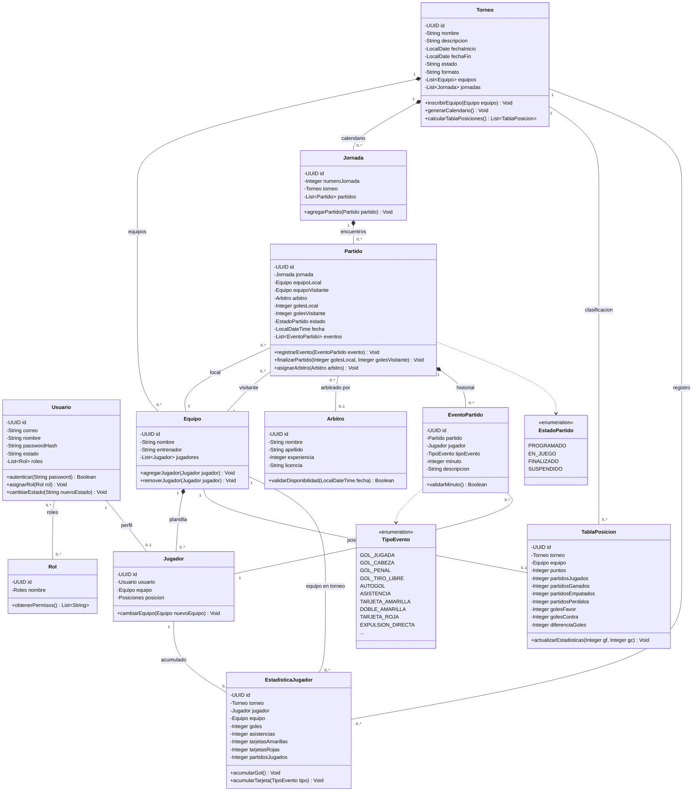

# Diagrama de Clases — Los Paisas

Este documento describe el **modelo de dominio** del sistema: las clases principales, sus atributos, sus relaciones y cómo se corresponden con el código real. Es el complemento orientado a objetos de [`DATABASE.md`](DATABASE.md) (que describe las tablas) y de [`STRUCTURE.md`](STRUCTURE.md) (que describe las carpetas).

> **Cómo leerlo:** el diagrama es un modelo **conceptual** del dominio. Las operaciones que aparecen en cada clase (`inscribirEquipo`, `finalizarPartido`...) indican *qué responsabilidades tiene ese concepto*, pero en la implementación la lógica de negocio vive en los **Services**, no en las entidades. La sección [Operaciones del diagrama y dónde viven en el código](#operaciones-del-diagrama-y-dónde-viven-en-el-código) hace esa traducción.

---

## Diagrama

**Notación:** `*--` es composición (la parte no existe sin el todo), `--` es asociación, `..>` es dependencia hacia una enumeración, `-` marca un atributo privado y `+` una operación pública. Las multiplicidades se leen en cada extremo de la relación (`"1"` exactamente uno, `"0..1"` opcional, `"0..*"` cero o muchos).

---

## Las clases, por grupo

### Usuarios y acceso

| Clase | Qué representa | Atributos a destacar |
|---|---|---|
| `Usuario` | Cuenta registrada en el sistema. Un jugador siempre tiene un usuario asociado. | `correo`, `nombre`, `passwordHash` (hoy sin hashing real, ver [limitaciones](#diferencias-entre-el-diagrama-y-el-código)) |
| `Rol` | Catálogo de roles de acceso. | `nombre` (enum `Roles`, único) |

### Estructura del torneo

| Clase | Qué representa | Atributos a destacar |
|---|---|---|
| `Torneo` | Competencia con fechas, estado y formato. Agrupa equipos y jornadas. | `fechaInicio`, `fechaFin`, `estado`, `formato` |
| `Equipo` | Club inscrito en un único torneo. | `nombre` (único), `entrenador` |
| `Jugador` | Perfil deportivo de un usuario dentro de un equipo. | `posicion` (enum `Posiciones`) |
| `Arbitro` | Colegiado que puede asignarse a los partidos. | `nombre`, `apellido`, `experiencia` (años), `licencia` |

### Calendario y encuentros

| Clase | Qué representa | Atributos a destacar |
|---|---|---|
| `Jornada` | Fecha o fase del calendario de un torneo. | `numeroJornada` |
| `Partido` | Enfrentamiento entre un equipo local y uno visitante, dentro de una jornada y con un árbitro. | `golesLocal`, `golesVisitante`, `estado`, `fecha` |
| `EventoPartido` | Suceso puntual dentro de un partido, ligado al jugador que lo realizó. | `tipoEvento`, `minuto`, `descripcion` |
| `EstadoPartido` *(enum)* | Ciclo de vida del partido. | `PROGRAMADO`, `EN_JUEGO`, `FINALIZADO`, `SUSPENDIDO` |
| `TipoEvento` *(enum)* | Clasificación de los eventos. | Goles, autogol, asistencia y tarjetas (ver nota abajo) |

### Rendimiento (datos derivados)

| Clase | Qué representa | Atributos a destacar |
|---|---|---|
| `TablaPosicion` | Fila de la clasificación de un equipo en un torneo. | `puntos`, `partidosJugados/Ganados/Empatados/Perdidos`, `golesFavor`, `golesContra`, `diferenciaGoles` |
| `EstadisticaJugador` | Acumulado individual de un jugador **en un torneo**. | `goles`, `asistencias`, `tarjetasAmarillas`, `tarjetasRojas`, `partidosJugados` |

Estas dos clases no se llenan a mano: el sistema las mantiene a partir de los partidos y los eventos registrados.

---

## Relaciones

| Relación | Multiplicidad | Significado |
|---|---|---|
| `Usuario` — `Rol` | N:M | El modelo permite varios roles por usuario (tabla `roles_usuario`). |
| `Usuario` — `Jugador` | 1 : 0..1 | Un usuario puede tener, como máximo, un perfil de jugador. |
| `Torneo` ◆ `Equipo` | 1 : 0..* | Un equipo pertenece a un solo torneo y ese torneo **no se puede cambiar** una vez registrado. |
| `Equipo` ◆ `Jugador` | 1 : 0..* | La plantilla del equipo. |
| `Torneo` ◆ `Jornada` | 1 : 0..* | El calendario del torneo. |
| `Jornada` ◆ `Partido` | 1 : 0..* | Los encuentros de una jornada. |
| `Partido` — `Equipo` | 0..* : 1 (dos veces) | Cada partido tiene un equipo **local** y uno **visitante**, que deben ser distintos. |
| `Partido` — `Arbitro` | 0..* : 0..1 | El árbitro asignado al partido. |
| `Partido` ◆ `EventoPartido` | 1 : 0..* | El historial del partido. |
| `EventoPartido` — `Jugador` | 0..* : 1 | Autor del evento. Debe pertenecer a uno de los dos equipos del partido. |
| `Torneo` — `TablaPosicion` — `Equipo` | 1 : 0..*, 1 : 0..1 | Cada equipo tiene, como máximo, una fila de posición. Se crea cuando el equipo se registra. |
| `Torneo` / `Jugador` / `Equipo` — `EstadisticaJugador` | 1 : 0..* | Las estadísticas se llevan por jugador **y por torneo**. |

---

## Reglas del dominio que el modelo implica

Estas reglas están implementadas en los Services (detalle en [`SERVICES.md`](SERVICES.md)):

- Un partido nace con marcador `0 - 0` y estado `PROGRAMADO`; el equipo local y el visitante no pueden ser el mismo.
- Solo un jugador de alguno de los dos equipos puede registrar eventos en un partido.
- Un `AUTOGOL` suma al equipo contrario y no cuenta como gol del jugador que lo cometió.
- Los goles (`GOL_JUGADA`, `GOL_CABEZA`, `GOL_PENAL`, `GOL_TIRO_LIBRE`) actualizan el marcador y los goles del jugador; `ASISTENCIA` suma asistencias; `TARJETA_AMARILLA` y `DOBLE_AMARILLA` suman amarillas; `TARJETA_ROJA` y `EXPULSION_DIRECTA` suman rojas.
- Cuando un partido pasa a `FINALIZADO` **por primera vez**, se actualiza la tabla de posiciones (3 puntos por victoria, 1 por empate, 0 por derrota) y se suma un partido jugado a los jugadores de ambos equipos.
- La tabla se ordena por puntos, diferencia de goles y goles a favor.
- Al modificar o eliminar un evento, primero se revierten sus efectos sobre marcador y estadísticas.
- Un equipo con partidos no se puede eliminar.

---

## Operaciones del diagrama y dónde viven en el código

| Clase | Operación del diagrama | Dónde se resuelve hoy |
|---|---|---|
| `Usuario` | `autenticar` | **No implementada.** No hay autenticación; `UsuarioService.obtenerEntidadPorEmail` queda reservado para ese módulo. |
| | `asignarRol` | `UsuarioService.crearUsuario` / `actualizarUsuario` (por `rolId`) |
| | `cambiarEstado` | No hay operación equivalente |
| `Rol` | `obtenerPermisos` | **No implementada** (no hay autorización) |
| `Torneo` | `inscribirEquipo` | `EquipoService.crearEquipo` (con `torneoId`); también crea la fila en la tabla de posiciones |
| | `generarCalendario` | **No implementada.** Las jornadas y los partidos se crean uno a uno (`JornadaService.crearJornada`, `PartidoService.crearPartido`) |
| | `calcularTablaPosiciones` | `TablaPosicionService.obtenerTabla` |
| `Equipo` | `agregarJugador` / `removerJugador` | `JugadorService.crearJugador` / `eliminarJugador` |
| `Jugador` | `cambiarEquipo` | `JugadorService.actualizarJugador` |
| `Arbitro` | `validarDisponibilidad` | **No implementada** |
| `Jornada` | `agregarPartido` | `PartidoService.crearPartido` (con `jornadaId`) |
| `Partido` | `registrarEvento` | `EventoPartidoService.registrarEvento` |
| | `finalizarPartido` | `PartidoService.cambiarEstado(FINALIZADO)` y `actualizarMarcador` |
| | `asignarArbitro` | Se asigna al crear el partido (`arbitroId`) |
| `EventoPartido` | `validarMinuto` | `@Valid` en el Request (0 a 130) y validación en `EventoPartidoServiceImpl` (no negativo) |
| `TablaPosicion` | `actualizarEstadisticas` | `TablaPosicionService.actualizarTabla(Partido)` |
| `EstadisticaJugador` | `acumularGol` / `acumularTarjeta` | `EstadisticaJugadorService.actualizarEstadisticas(...)` y `revertirEstadisticas(...)` |

---

## Diferencias entre el diagrama y el código

Para que nadie se lleve sorpresas al comparar este diagrama con las clases reales:

- **Un rol por usuario en la API.** El modelo y la base de datos permiten varios roles por usuario (`roles_usuario`), pero `UsuarioRequest` y `UsuarioResponse` trabajan con un único `rolId` / `rol`.
- **Nombres de atributos.** La API expone el correo como `email`. El atributo `estado` de `Usuario` no se expone en ningún DTO.
- **`TipoEvento` es una lista parcial.** Se muestran los valores documentados en los Services; el enum real incluye más (por ejemplo, sustituciones y lesiones). La fuente de verdad es `models/enums/TipoEvento.java`.
- **Enums con nombre propio.** `Posiciones` y `Roles` son enumerados; sus valores están en `models/enums/`.
- **Operaciones sin implementar.** `autenticar`, `obtenerPermisos`, `generarCalendario` y `validarDisponibilidad` son parte del diseño del dominio pero todavía no existen en el código.
- **Seguridad.** `passwordHash` se guarda hoy tal como llega, sin hashing (ver [`DTOS.md`](DTOS.md), sección 8).
- **Estadísticas por torneo.** El diagrama permite varios registros de `EstadisticaJugador` por jugador (uno por torneo). En el diagrama ER de [`DATABASE.md`](DATABASE.md) aparece como 1:1 porque un jugador pertenece a un solo equipo y, por tanto, a un solo torneo.

---

## Cómo mantener este documento

1. Si agregas, renombras o eliminas una **entidad** o un **atributo**, actualiza el bloque `mermaid` y la tabla del grupo correspondiente.
2. Si agregas o cambias una **relación** (por ejemplo, una FK nueva), actualiza las relaciones del diagrama y la tabla de relaciones, y revisa `DATABASE.md`.
3. Si implementas una operación marcada como *no implementada*, pasa su fila a "dónde se resuelve hoy" y quítala de [Diferencias](#diferencias-entre-el-diagrama-y-el-código).
4. Si agregas un valor a un enum, actualízalo aquí si es de los que se muestran en el diagrama.
5. Verifica el diagrama pegando el bloque en [mermaid.live](https://mermaid.live) o abriendo el archivo en GitHub, que lo renderiza automáticamente.