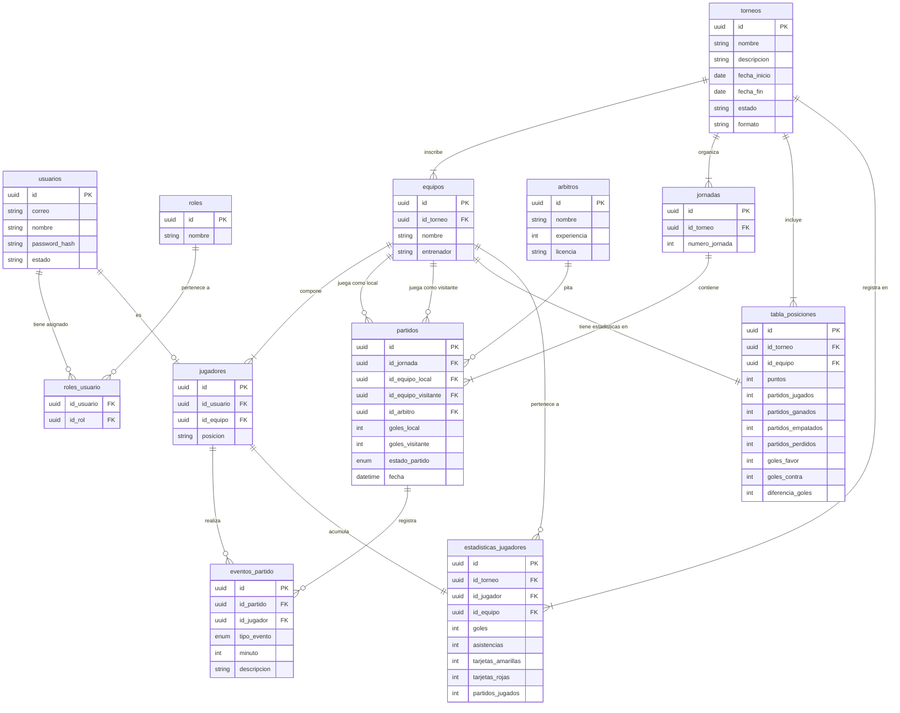

# Base de Datos — Torneo Manager (Los Paisas)

Este documento detalla el diseño relacional, el diagrama Entidad-Relación y el diccionario de datos de la base de datos MySQL utilizada por el sistema.

---

## 📐 Diagrama Entidad-Relación (Mermaid)

## 🗂️ Diccionario de Tablas

### 1. Usuarios y Seguridad
* **`usuarios`**: Cuentas registradas en el sistema (autenticación).
* **`roles`**: Catálogo de roles de acceso (Ej: `ADMIN`, `USUARIO`, `ORGANIZADOR`).
* **`roles_usuario`**: Tabla intermedia N:M para asignar uno o más roles a un usuario.

### 2. Estructura del Torneo
* **`torneos`**: Información principal del torneo (`fecha_inicio`, `fecha_fin`, `formato`, `estado`).
* **`equipos`**: Clubes o equipos inscritos en un torneo específico (`id_torneo`).
* **`jugadores`**: Mapeo entre un `usuario`, su `equipo` asignado y su `posicion` en el campo.
* **`arbitros`**: Registro de colegiados encargados de impartir justicia en los partidos (`experiencia`, `licencia`).

### 3. Calendario y Encuentros
* **`jornadas`**: Fases o fechas del calendario pertenecientes a un torneo (`numero_jornada`).
* **`partidos`**: Enfrentamiento directo entre dos equipos (`id_equipo_local`, `id_equipo_visitante`), asignado a una jornada y pitado por un árbitro. Mantiene el marcador general y su estado (`PROGRAMADO`, `EN_JUEGO`, `FINALIZADO`, `SUSPENDIDO`).
* **`eventos_partido`**: Sucesos puntuales dentro del encuentro (`GOL`, `ASISTENCIA`, `AMARILLA`, `ROJA`, `SUSTITUCION`) vinculados al jugador que lo realizó y al minuto correspondiente.

### 4. Tablas Acumulativas / Rendimiento
* **`tabla_posiciones`**: Cálculo resumido de la fase de grupos o liga (Puntos, DG, GF, GC, PG, PE, PP) por equipo dentro de un torneo.
* **`estadisticas_jugadores`**: Consolidado individual del desempeño de cada jugador en un torneo (Tabla de goleo, asistencias, tarjetas y partidos jugados).